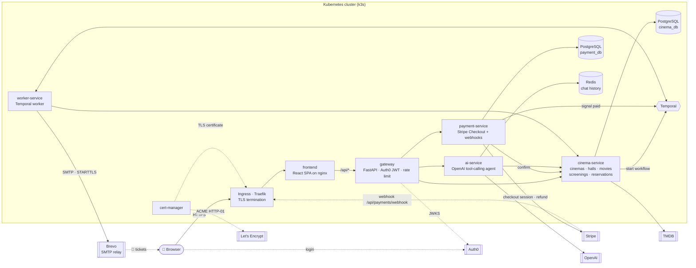
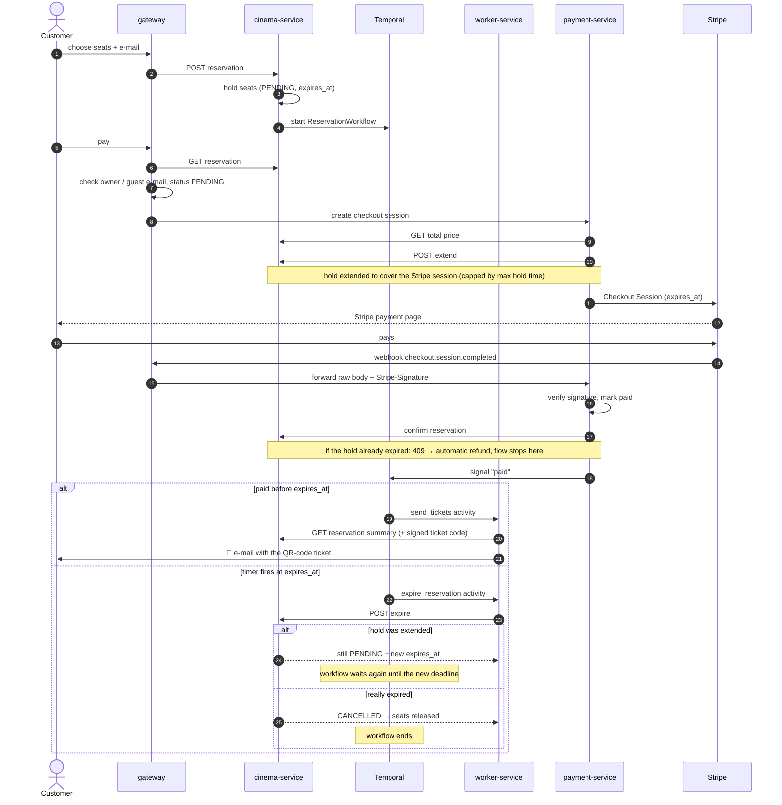
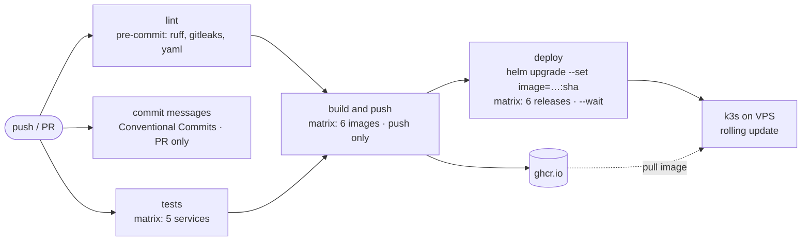

# 🎬 CinemaApp — Cinema Reservation System

[](https://github.com/damiankowalczykdk/cinema-reservation-system/actions/workflows/ci-cd.yaml)


A microservice cinema booking platform: browse the repertoire, pick seats on an interactive hall map,
pay with Stripe and receive tickets with QR codes by e-mail — or let an **AI assistant** book
the whole thing for you in a chat.

### 🌐 Live demo: **https://cinema.damian-kowalczyk.dev**

Running on a single VPS with k3s, deployed automatically from `main`. Payments are in Stripe **test mode** —
use card `4242 4242 4242 4242`, any future date and any CVC. Ticket e-mails are delivered to real inboxes —
book with your own address to receive the QR-code ticket.

---

## ✨ Features

- **Repertoire & trailers** — movies currently in cinemas, a day-by-day schedule filtered by cinema, and YouTube trailers
- **TMDB integration** — the admin adds a movie by title; its poster and trailer are fetched from TMDB automatically
- **Interactive seat map** — choose several seats at once, seats already taken are blocked
- **Guest checkout** — booking works without an account; tickets go to the e-mail given at checkout
- **My tickets** — logged-in users see their bookings and can cancel them before the screening, with an automatic Stripe refund
- **Stripe Checkout** — secure payment, confirmed via Stripe webhooks; automatic refund if the payment
  arrives after the reservation has already expired
- **Reservation hold with expiry** — seats are held for a limited time; a durable Temporal workflow releases them if the payment never arrives
- **Tickets by e-mail** — after payment the customer gets one e-mail with an HMAC-signed QR code for the whole booking,
  verifiable at the entrance via `/reservations/ticket/verify`
- **AI assistant** — an OpenAI tool-calling agent that searches screenings, shows the seat map and creates a reservation from a conversation
- **Auth0 login & roles** — JWT verified only in the API gateway; admin console for cinemas, halls, movies,
  screenings and reservations
- **PL / EN** interface

## 📸 Screenshots

| Home page | Seat selection |
|---|---|
|  |  |

| AI assistant | Booking through the chat |
|---|---|
|  |  |

| Stripe Checkout (test mode) | Payment confirmed |
|---|---|
|  |  |

| Ticket e-mail with QR code | Admin console |
|---|---|
|  |  |

---

## 🏗️ Architecture

Every API request from the browser goes through the **gateway** — the only backend service exposed to the
outside world and the only place where authentication happens. Internal services trust the gateway.
In Kubernetes the Ingress (Traefik on k3s, with a Let's Encrypt certificate from cert-manager) serves the
frontend, and its nginx proxies `/api/*` to the gateway, so the whole app lives under a single HTTPS origin.
Stripe webhooks take the same public path and the gateway forwards them to payment-service.



| Service | Responsibility | Tech |
|---|---|---|
| `frontend` | SPA: repertoire, trailers, seat map, checkout, AI chat, my tickets, admin console | React 19, React Router, Radix UI, Vite, nginx |
| `gateway` | Single entry point, Auth0 login flow and JWT validation, roles, rate limiting, proxy to services, Stripe webhook pass-through | FastAPI, PyJWT, slowapi |
| `cinema-service` | Core domain — cinemas, halls, movies, screenings, reservations, seat map, ticket summary | FastAPI, SQLAlchemy 2 (async), asyncpg, Alembic |
| `payment-service` | Stripe Checkout sessions, webhook verification, payment status | FastAPI, Stripe, SQLAlchemy, Alembic |
| `ai-service` | Booking assistant — OpenAI function calling over the cinema API, conversation history per user | FastAPI, OpenAI SDK, Redis |
| `worker-service` | Temporal workflows & activities: reservation expiry, ticket e-mails with QR codes | Temporal, aiosmtplib, qrcode |

## 🔄 Booking flow

The reservation lifecycle is a **Temporal workflow**. It survives restarts of any service, waits for the
payment signal and either sends the tickets or releases the seats when the hold expires.

Starting a payment extends the hold so it always outlives the Stripe session. The workflow is never told
about the extension. When its timer fires, cinema-service decides: if the hold was extended, it returns
the new deadline and the workflow simply waits again.



## 🧠 Design decisions

- **Auth only in the gateway** — services sit on a private network and never parse tokens; user identity
  is forwarded in headers. One place to secure, simpler services. The gateway runs the Auth0 login itself
  and keeps the access token in an HttpOnly cookie, so JavaScript in the browser never touches it.
- **Database per service** — `cinema-service` and `payment-service` each own a separate PostgreSQL instance
  (in Compose and in Kubernetes) and talk only over HTTP, so neither can break the other's data.
- **Temporal instead of a cron job** for the payment hold — the timeout and the "paid" signal live in one
  durable workflow, so a crash or redeploy never loses a pending expiry or an unsent ticket. As a safety
  net, stale holds are also expired lazily whenever a screening's seats are read.
- **Idempotent payments** — clicking "pay" twice returns the same open Stripe session instead of creating a
  new one, and repeated webhooks for an already completed or refunded payment are ignored.
- **One booking = N seats** — seats reserved together share a `group_id`, so a single payment and a single
  e-mail cover the whole group.
- **QR tickets without an extra column** — the ticket code is an HMAC-SHA256 signature of the booking id,
  recomputed on demand, so it can be verified at the door (`/reservations/ticket/verify`) but cannot be forged.
- **AI assistant with hard limits** — capped tool-call rounds and output tokens, rate-limited in the
  gateway, conversation history kept in our own Redis (TTL + owner check) with `store=False` on the OpenAI side.
- **One Helm chart for all apps** — every app is "a container with env vars", optionally with an HTTP port,
  health probes and a migrations `initContainer`; a small `values.yaml` per app switches these on, so one
  generic chart replaces six copies of manifests.
- **Stripe webhooks through the gateway, byte for byte** — payment-service is not reachable from the internet,
  so the gateway forwards the webhook untouched (raw body + `Stripe-Signature`). Re-serialising the JSON would
  break the HMAC signature; the signature itself is verified only in payment-service, where the secret lives.
- **One image, many environments** — images are identical everywhere; differences (public URLs, `COOKIE_SECURE`,
  SMTP relay, pull policy) live in ConfigMaps, Secrets and `values-prod.yaml`. SMTP credentials are optional
  settings, so the same worker image sends to Mailpit locally without authentication and to Brevo in production.
  The image tag is set only by CI (`--set image=…:<sha>`), so what runs in production always maps to exactly
  one commit.

---

## 🧰 Tech stack

- **Backend:** Python 3.13, FastAPI, Pydantic v2, SQLAlchemy 2 (async), Alembic, httpx, Poetry
- **Workflows:** Temporal
- **Data:** PostgreSQL 16, Redis 7
- **Integrations:** Auth0, Stripe Checkout, OpenAI Responses API (function calling), TMDB, Brevo (SMTP relay)
- **Frontend:** React 19, React Router, Vite, Radix UI, oxlint
- **Testing:** pytest, pytest-asyncio, pytest-cov (100% line coverage), testcontainers (real PostgreSQL in integration tests), respx
- **Quality:** mypy, ruff, gitleaks, pre-commit, Conventional Commits
- **Local dev tools:** Stripe CLI (webhook forwarding), Mailpit (e-mail catcher), Temporal UI
- **Infrastructure:** Docker (multi-stage builds), Docker Compose, Kubernetes (minikube locally, k3s in production), Helm,
  NGINX Ingress / Traefik, cert-manager + Let's Encrypt, Portainer, Contabo VPS (Ubuntu 24.04, ufw)
- **CI/CD:** GitHub Actions → GitHub Container Registry → `helm upgrade` on k3s

## 📁 Project structure

```
.
├── apps/
│   ├── frontend/          # React SPA (served by nginx in Docker)
│   ├── gateway/           # API gateway, auth
│   ├── cinema-service/    # core domain + Alembic migrations
│   ├── payment-service/   # Stripe + Alembic migrations
│   ├── ai-service/        # AI booking assistant
│   └── worker-service/    # Temporal worker
├── k8s/
│   ├── chart/             # one generic Helm chart for every app
│   ├── apps/<service>/    # values.yaml + ConfigMaps; *-prod.yaml overrides for k3s (Secrets are gitignored)
│   ├── infra/             # Postgres, Redis, Temporal, Mailpit
│   ├── ingress.yaml       # minikube (NGINX, http://localhost)
│   ├── ingress-prod.yaml  # k3s (Traefik, TLS via cert-manager)
│   ├── redirect-https.yaml # Traefik middleware: HTTP → HTTPS
│   ├── cluster-issuer.yaml # Let's Encrypt issuer for cert-manager
│   └── namespace.yaml
├── docker-compose.yml     # full local environment
└── .github/workflows/ci-cd.yaml
```

---

## 🚀 Running locally

### Docker Compose

Requirements: Docker, Node.js 24, plus Auth0 / Stripe (test mode) / OpenAI / TMDB keys.

**1. Environment files** — copy the examples and fill in your keys:

```bash
cp .env.example .env
cp apps/cinema-service/.env.example apps/cinema-service/.env
cp apps/payment-service/.env.example apps/payment-service/.env
cp apps/ai-service/.env.example apps/ai-service/.env
cp apps/worker-service/.env.example apps/worker-service/.env
cp apps/gateway/.env.example apps/gateway/.env
```

**2. Start the backend** (all services, two PostgreSQL instances, Redis, Temporal, Mailpit, Stripe CLI):

```bash
docker compose up --build -d
```

**3. First run only — database migrations:**

```bash
docker compose exec cinema-service alembic upgrade head
docker compose exec payment-service alembic upgrade head
```

**4. Stripe webhook secret** — the `stripe-cli` container prints a `whsec_...` secret on start. Put it into
`STRIPE_WEBHOOK_SECRET` in `apps/payment-service/.env` and restart the service:

```bash
docker compose logs stripe-cli
docker compose restart payment-service
```

**5. Start the frontend:**

```bash
cd apps/frontend
npm install
npm run dev
```

| URL | What |
|---|---|
| http://localhost:3000 | Frontend |
| http://localhost:8000/docs | API gateway (Swagger) |
| http://localhost:8233 | Temporal UI |
| http://localhost:8025 | Mailpit — caught ticket e-mails |
| `localhost:5432` / `localhost:5433` | PostgreSQL — `cinema_db` / `payment_db` (for a DB client) |

Test payments work with card `4242 4242 4242 4242`, any future date and any CVC.

#### Auth0 setup

- **Application** (Regular Web App):
  - *Allowed Callback URLs*: `http://localhost:8000/auth/callback`
  - *Allowed Logout URLs*: `http://localhost:3000` — must match `APP_BASE_URL`
  - in production add the public `https://<host>/api/auth/callback` and `https://<host>` as well
- **API**: its identifier is `AUTH0_AUDIENCE` in `apps/gateway/.env`.
- **Roles**: create `admin` and `user`, and assign `admin` to your account to unlock the admin console.
- **Post-login Action**: add the custom claims the gateway reads from the access token —
  `my-namespace/globalRoles` (list of role names) and `my-namespace/email`.

> **Empty home page?** It lists only movies with **upcoming** screenings — add a cinema, a hall, a movie
> and a few screenings with a future `start_time` in the admin console.

### Tests

Every backend service has **100% line coverage**. Each service is tested independently from its own folder.
Integration tests start a real PostgreSQL with testcontainers, so Docker must be running.

```bash
cd apps/cinema-service
poetry install
poetry run pytest --cov
```

---

## ⚙️ CI/CD



- **lint** — all pre-commit hooks on the whole repo
- **commits** — every commit in a PR must follow Conventional Commits
- **test** — pytest for each backend service in a matrix
- **build** — on push, Docker images for all 6 apps are pushed to GHCR, tagged with the commit SHA and `latest`
- **deploy** — after a successful build, `helm upgrade` points each release at the new SHA tag; k3s pulls the
  image and swaps pods with a rolling update. The kubeconfig comes from the `KUBE_CONFIG` repository secret;
  production ConfigMaps and Secrets are managed by hand, so CI never sees application credentials.

## ☁️ Production (k3s on a VPS)

The live demo runs on one Contabo VPS (4 vCPU, 8 GB RAM) with **k3s** — a lightweight Kubernetes
distribution that ships with Traefik (Ingress) and local-path storage (PVCs). The same manifests and Helm
chart are used as in minikube; production differences are kept in `*-prod.yaml` files.

- **Server** — SSH key login only (password auth disabled), `ufw` allows only SSH, 80, 443 and the k3s API
- **Secrets** — created with `kubectl create secret … --from-literal`, never committed; new values for
  production (database passwords, `TICKET_SECRET`, session secret)
- **HTTPS** — cert-manager with a Let's Encrypt `ClusterIssuer` (HTTP-01 through Traefik); the Ingress
  annotation `cert-manager.io/cluster-issuer` requests and renews the certificate automatically.
  A Traefik `redirectScheme` middleware permanently redirects HTTP to HTTPS (308)
- **Domain** — the demo lives on a subdomain of my own domain: an `A` record for `cinema` points at the VPS,
  while the rest of the domain keeps serving its existing site
- **Cookies** — `COOKIE_SECURE=true` in production marks the auth and session cookies as `Secure`
- **Stripe** — a webhook destination points at `https://<host>/api/payments/webhook`; its signing secret is
  stored in `payment-secret`
- **E-mail** — the worker sends tickets through the Brevo SMTP relay (port 587, STARTTLS); the SMTP login and
  key are stored in `worker-secret`. The domain is authenticated in Brevo (DKIM + DMARC records), so ticket
  e-mails pass DMARC and land in the inbox instead of spam
- **OpenAI** — prepaid credits with auto-reload off act as a hard spending cap for the public assistant
- **Observability** — Portainer (not exposed publicly, reached via `kubectl port-forward`) for pods, logs
  and events; databases are reached the same way

First install, in short:

```bash
kubectl apply -f k8s/namespace.yaml
kubectl apply -R -f k8s/infra/                     # + kubectl create secret … for the databases
kubectl apply -f k8s/apps/<app>/configmap.yaml     # and configmap-prod.yaml where it exists
helm install <app> k8s/chart -n cinema \
  -f k8s/apps/<app>/values.yaml -f k8s/apps/<app>/values-prod.yaml \
  --set image=ghcr.io/damiankowalczykdk/cinema-reservation-system/<image>:<sha>

helm install cert-manager jetstack/cert-manager -n cert-manager --create-namespace --set crds.enabled=true
kubectl apply -f k8s/cluster-issuer.yaml
kubectl apply -f k8s/redirect-https.yaml           # before the Ingress that references it
kubectl apply -f k8s/ingress-prod.yaml
```

The Helm release name must match the app folder name — the chart names the Service `<release>-service`,
which is how the apps find each other (e.g. `http://cinema-service:8001`). Database migrations run
automatically in an `initContainer` before the service starts. The same manifests also run on minikube
(`k8s/ingress.yaml`, NGINX Ingress, locally built images).

After that every push to `main` is deployed by CI.

---

## 👤 Author

**Damian Kowalczyk** — [Portfolio](https://damian-kowalczyk.dev) · [GitHub](https://github.com/damiankowalczykdk)
